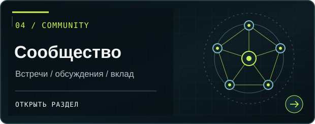

**Финансовая грамотность через практику, а не обещания.**

[О клубе](docs/ABOUT.md) · [Участие](CONTRIBUTING.md) · [Обсуждения](https://github.com/Sashido01/21percent/discussions) · [Дорожная карта](ROADMAP.md)

 · [Текущая версия](VERSION) · [История изменений](CHANGELOG.md)

## 01 / Выберите направление

[Исследования](research/README.md) · [Практикум](practice/README.md) · [Эксперименты](projects/README.md) · [Сообщество](events/README.md)

## 02 / Вход в SIGNAL ROOM

Финансовый клуб 21% — образовательное сообщество Школы 21. Вместе разбираемся в деньгах, экономике, инвестициях и технологиях. Здесь можно принести вопрос, проверить собственную идею, поделиться опытом и сделать полезную вещь вместе.

| Что хотите сделать? | С чего начать |
| :--- | :--- |
| Проверить финансовую новость | [Методика исследования](research/METHOD.md) |
| Разобраться в реальной доходности | [Кейс 01 — инфляция](practice/01-real-return.md) |
| Проверить финансовую устойчивость | [Кейс 02 — резерв](practice/02-reserve.md) |
| Предложить тему встречи или проект | [Правила участия](CONTRIBUTING.md) · [Обсуждения](https://github.com/Sashido01/21percent/discussions) |

## 03 / Что происходит в клубе

- **Уже было:** очные встречи, финансовые обсуждения, разборы инструментов и голосования по образовательному инвестиционному эксперименту.
- **В работе и планах:** игровые форматы, исследовательские материалы, финансовые инструменты и технологические проекты. Фактические статусы — в [каталоге инициатив](projects/README.md).
- **21% INVEST** — наблюдение за личным портфелем организатора и обсуждение решений. Не коллективный портфель, не общий счёт, не управление чужими средствами. [Подробнее](projects/INVEST.md).

## 04 / Открытая лаборатория

[Документация](docs/README.md) · [Правила публикации](docs/PUBLISHING.md) · [Принципы общения](CODE_OF_CONDUCT.md) · [Визуальная система](docs/DESIGN.md)

**21% — название клуба, а не обещанная доходность.** Материалы образовательные и не являются индивидуальными инвестиционными рекомендациями.
