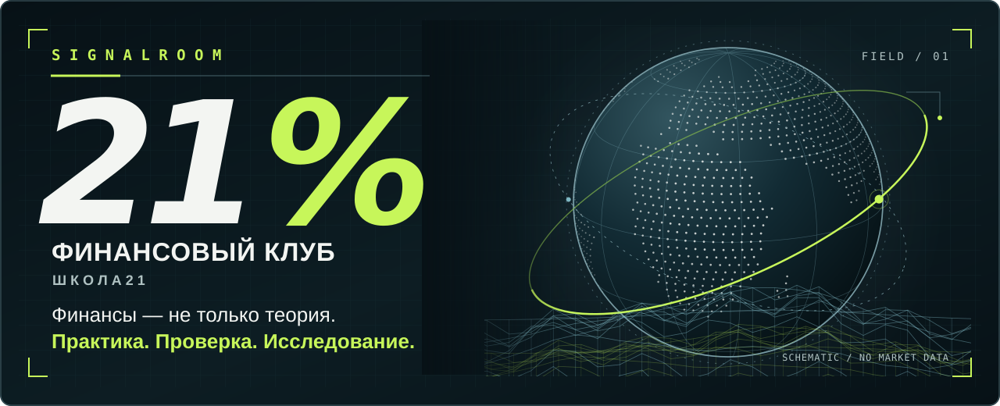
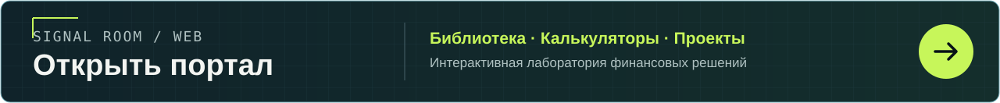
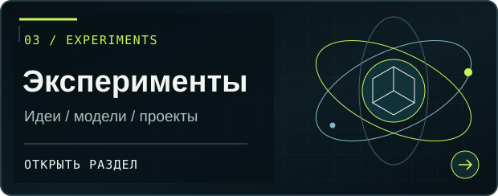
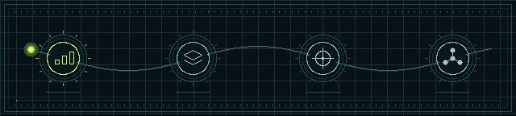

**[Открыть интерактивный портал ↗](https://sashido01.github.io/21percent/)** · [Цифровой рубль](docs/ruble/index.html) · [Исследования и вопросы](docs/ruble/index.html) · [О клубе](docs/ABOUT.md) · [Как участвовать](CONTRIBUTING.md)

## 01 / Выберите направление

[Исследования](research/README.md) · [Практикум](practice/README.md) · [Эксперименты](projects/README.md) · [Сообщество](events/README.md)

Сигнал / анимация движения между направлениями

[Открыть анимацию отдельно](assets/brand/signal-motion.gif)

## 02 / Интерактивная лаборатория

Выберите сценарий — панели раскрываются прямо здесь. Для полноценного интерактива откройте [портал SIGNAL ROOM](https://sashido01.github.io/21percent/#practice).

<strong>01 / Исследователь — проверить финансовую новость</strong>

Начните с проверяемого утверждения, найдите первоисточник, сверяйте дату и условия. Не путайте намерение, принятие закона и его вступление в силу.

[Открыть методику](research/METHOD.md) · [Шаблон исследования](research/TEMPLATE.md)

<strong>02 / Практик — решите задачу за минуту</strong>

У вас условные 100 000 ₽. За год сумма выросла на 12%, а цены — на 8%. Какова реальная доходность без налогов и комиссий?

**Выберите ответ мысленно, затем откройте соответствующую панель.**

A — 4%

Это приблизительная разница ставок, но не точный результат. Реальная доходность учитывает отношение индексов.

B — около 3,70%

Верно: (1,12 / 1,08 − 1) × 100% ≈ 3,70%. Реальная покупательная способность составляет около 103 704 ₽ в ценах начала года.

C — 12%

Это номинальная доходность. Она не учитывает изменение цен.

[Полный кейс](practice/01-real-return.md) · [Следующая задача: финансовый резерв](practice/02-reserve.md)

<strong>03 / Экспериментатор — проверить идею</strong>

Предложите гипотезу, определите исходные данные, критерий успеха и ограничение риска. Зафиксируйте результат независимо от того, подтвердилась ли гипотеза.

[Каталог инициатив](projects/README.md) · [Предложить идею в Issues](https://github.com/Sashido01/21percent/issues/new/choose)

<strong>04 / Участник — предложить встречу или обсудить вопрос</strong>

Выберите тему, обозначьте практическую пользу и предложите формат. Обсуждение не требует создания задачи в Issues.

[Открыть Discussions](https://github.com/Sashido01/21percent/discussions) · [Встречи](events/README.md) · [Как участвовать](CONTRIBUTING.md)

## 03 / Финансы, которые можно проверить

Финансовый клуб 21% — образовательное сообщество Школы 21. Исследуем деньги, экономику и технологии; проверяем идеи и создаём полезные проекты вместе.

- Очные встречи, финансовые обсуждения и разборы инструментов уже проводились.
- Игры, исследования и совместные инструменты развиваются; реальные стадии — в [каталоге инициатив](projects/README.md).
- [21% INVEST](projects/INVEST.md) — наблюдение за личным инвестиционным экспериментом организатора, не общий счёт и не управление чужими средствами.

[Обсудить идею](https://github.com/Sashido01/21percent/discussions) · [Предложить проект](https://github.com/Sashido01/21percent/issues/new/choose) · [Архив встреч](events/README.md)

**21% — название клуба, а не обещанная доходность.** Материалы образовательные, не индивидуальная инвестиционная рекомендация.

---

Репозиторий / версия, проверки и документация

[Версия](VERSION) · [История изменений](CHANGELOG.md) · [Дорожная карта](ROADMAP.md) · [Документация](docs/README.md) · [Дизайн](docs/DESIGN.md) · [Публикация](docs/PORTAL.md) · [Правила](docs/PUBLISHING.md) · [Принципы общения](CODE_OF_CONDUCT.md)

