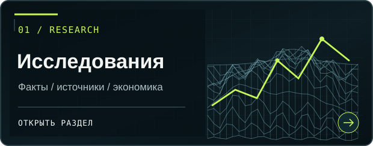
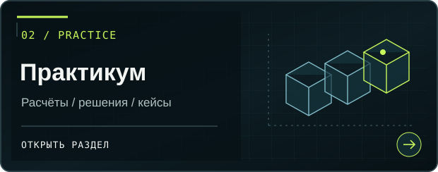

**Финансовая грамотность через практику, а не обещания.** 

[Открыть анимацию отдельно](assets/brand/signal-motion.gif)

[О клубе](docs/ABOUT.md) · [Участие](CONTRIBUTING.md) · [Обсуждения](https://github.com/Sashido01/21percent/discussions) · [Дорожная карта](ROADMAP.md)

 · [Текущая версия](VERSION) · [История изменений](CHANGELOG.md)

## 01 / Выберите направление

[Исследования](research/README.md) · [Практикум](practice/README.md) · [Эксперименты](projects/README.md) · [Сообщество](events/README.md)

## 02 / Интерактивная лаборатория

Выберите сценарий — панели раскрываются прямо на этой странице.

<strong>01 / Исследователь — проверить финансовую новость</strong>

Начните с проверяемого утверждения, найдите первоисточник, сверяйте дату и условия. Не путайте намерение, принятие закона и его вступление в силу.

[Открыть методику](research/METHOD.md) · [Шаблон исследования](research/TEMPLATE.md)

<strong>02 / Практик — решите задачу за минуту</strong>

У вас условные 100 000 ₽. За год сумма выросла на 12%, а цены — на 8%. Какова реальная доходность без налогов и комиссий?

**Выберите ответ мысленно, затем откройте соответствующую панель.**

A — 4%

Это приблизительная разница ставок, но не точный результат. Реальная доходность учитывает отношение индексов.

B — около 3,70%

Верно: (1,12 / 1,08 − 1) × 100% ≈ 3,70%. Реальная покупательная способность составляет около 103 704 ₽ в ценах начала года.

C — 12%

Это номинальная доходность. Она не учитывает изменение цен.

[Полный кейс](practice/01-real-return.md) · [Следующая задача: финансовый резерв](practice/02-reserve.md)

<strong>03 / Экспериментатор — проверить идею</strong>

Предложите гипотезу, определите исходные данные, критерий успеха и ограничение риска. Зафиксируйте результат независимо от того, подтвердилась ли гипотеза.

[Каталог инициатив](projects/README.md) · [Предложить идею в Issues](https://github.com/Sashido01/21percent/issues/new/choose)

<strong>04 / Участник — предложить встречу или обсудить вопрос</strong>

Выберите тему, обозначьте практическую пользу и предложите формат. Обсуждение не требует создания задачи в Issues.

[Открыть Discussions](https://github.com/Sashido01/21percent/discussions) · [Встречи](events/README.md) · [Как участвовать](CONTRIBUTING.md)

## 03 / Вход в SIGNAL ROOM

Финансовый клуб 21% — образовательное сообщество Школы 21. Вместе разбираемся в деньгах, экономике, инвестициях и технологиях. Здесь можно принести вопрос, проверить собственную идею, поделиться опытом и сделать полезную вещь вместе.

| Что хотите сделать? | С чего начать |
| :--- | :--- |
| Проверить финансовую новость | [Методика исследования](research/METHOD.md) |
| Разобраться в реальной доходности | [Кейс 01 — инфляция](practice/01-real-return.md) |
| Проверить финансовую устойчивость | [Кейс 02 — резерв](practice/02-reserve.md) |
| Предложить тему встречи или проект | [Правила участия](CONTRIBUTING.md) · [Обсуждения](https://github.com/Sashido01/21percent/discussions) |

## 04 / Что происходит в клубе

- **Уже было:** очные встречи, финансовые обсуждения, разборы инструментов и голосования по образовательному инвестиционному эксперименту.
- **В работе и планах:** игровые форматы, исследовательские материалы, финансовые инструменты и технологические проекты. Фактические статусы — в [каталоге инициатив](projects/README.md).
- **21% INVEST** — наблюдение за личным портфелем организатора и обсуждение решений. Не коллективный портфель, не общий счёт, не управление чужими средствами. [Подробнее](projects/INVEST.md).

## 05 / Открытая лаборатория

[Документация](docs/README.md) · [Правила публикации](docs/PUBLISHING.md) · [Принципы общения](CODE_OF_CONDUCT.md) · [Визуальная система](docs/DESIGN.md)

**21% — название клуба, а не обещанная доходность.** Материалы образовательные и не являются индивидуальными инвестиционными рекомендациями.
