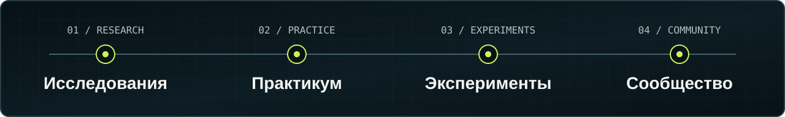
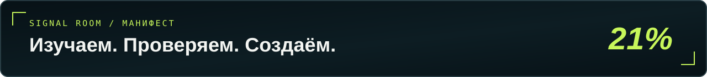

**Финансовая грамотность через практику, а не обещания.**

[О клубе](docs/ABOUT.md) · [Исследования](research/README.md) · [Практикум](practice/README.md) · [Проекты](projects/README.md) · [Участие](CONTRIBUTING.md)

---

## 01 / Зачем мы здесь

Финансовый клуб 21% — сообщество Школы 21, которое формируется с июня 2026 года в Белгороде. Мы разбираемся в деньгах, экономике, инвестициях и технологиях; учимся принимать решения и проверять идеи на практике.

> Это не место, где один человек рассказывает остальным, как правильно обращаться с деньгами. Это площадка, где можно проверить собственную идею, поделиться опытом и сделать что-то полезное вместе.

**21% — название клуба, а не обещанная доходность.**

## 02 / Карта клуба

| Направление | Что здесь происходит | Открыть |
| :--- | :--- | :--- |
| **01. Знания** | Проверяем источники, разбираем экономику и финансовые новости. | [Исследования](research/README.md) |
| **02. Практика** | Считаем, сравниваем альтернативы, разбираем последствия решений. | [Практикум](practice/README.md) |
| **03. Эксперименты** | Изучаем инвестиции, финансовые игры и технологические решения. | [Проекты](projects/README.md) |
| **04. Сообщество** | Обсуждаем, предлагаем темы, объединяемся для совместных проектов. | [Встречи](events/README.md) |

## 03 / От слов к действиям

- **Уже было:** очные встречи, финансовые обсуждения, разборы инструментов и голосования по образовательному инвестиционному эксперименту.
- **В работе и в планах:** игровые форматы, исследовательские материалы, полезные финансовые инструменты и технологические проекты. Статусы отдельно отражены в [каталоге](projects/README.md).
- **21% INVEST:** наблюдение за личным портфелем организатора и обсуждение решений. Это не коллективный портфель, не общий счёт и не управление чужими средствами.

## 04 / Начните с решения

Возьмите [первый практический кейс](practice/01-real-return.md), предложите собственный сценарий или проверьте финансовую новость по [методике исследования](research/METHOD.md). Не обязательно быть экспертом, чтобы внести полезный вклад.

[Как предложить идею или материал](CONTRIBUTING.md) · [Принципы общения](CODE_OF_CONDUCT.md)

## 05 / Как устроен репозиторий

| Раздел | Назначение |
| :--- | :--- |
| [docs](docs/README.md) | Миссия, устройство клуба и визуальная система |
| [research](research/README.md) | Методика и направления исследований |
| [practice](practice/README.md) | Учебные задачи и эксперименты |
| [events](events/README.md) | Архив и правила документирования встреч |
| [projects](projects/README.md) | Каталог инициатив и их реальный статус |
| [assets](assets/README.md) | Авторская графика репозитория |

[Дорожная карта](ROADMAP.md) · [История изменений](CHANGELOG.md) · [Правила публикации](docs/PUBLISHING.md)

---

Материалы образовательные, не являются индивидуальными инвестиционными рекомендациями.

